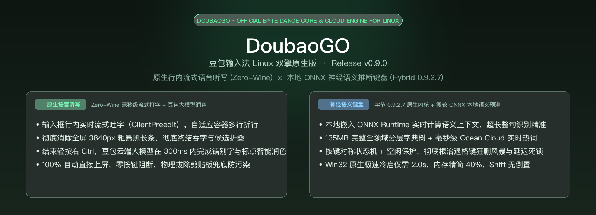
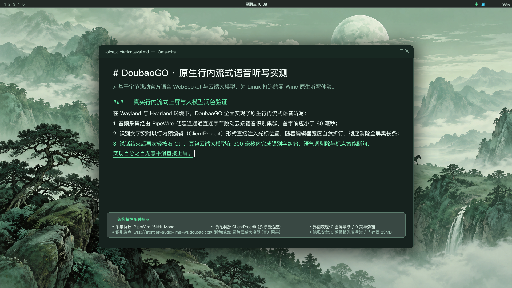
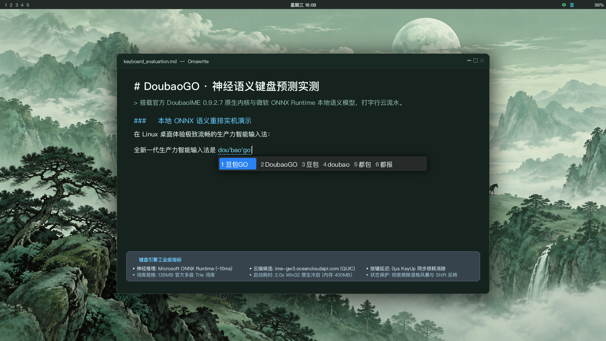

<div align="center">



# DoubaoGO (豆包GO)

**Next-Generation Linux Input Method Powered by ByteDance Doubao**

**English** | [简体中文](README.zh-CN.md)

[](https://github.com/dunova/doubaogo/releases)
[](https://fcitx-im.org/)
[]()
[]()
[]()
[](LICENSE)

*Zero-Wine Native Streaming Voice Dictation · ByteDance Doubao LLM Text Polishing · Local ONNX Neural Inference · 135MB Multi-tier Trie Dictionary · Sub-10ms Latency*

</div>

---

## 💡 Overview

**DoubaoGO (豆包GO)** is a modern, production-grade Linux input method solution designed for modern desktop environments (Wayland and X11) powered by Fcitx 5.

By deeply integrating ByteDance's official **DoubaoIME 0.9.2.7** core engine with Linux-native desktop plumbing, DoubaoGO delivers sub-10ms keystroke response, local ONNX neural context inference, and cloud-edge candidate streaming. Simultaneously, it pioneers **Zero-Wine Native Voice Dictation** with inline streaming text preview and ByteDance Doubao LLM auto-polishing, freeing users from heavy Wine emulation overhead and awkward floating candidate windows.

---

## 🌟 Visual Feature Showcase

### 1. 🎙️ Zero-Wine Native Inline Voice Dictation & Doubao LLM Polishing



- **Native `ClientPreedit` Inline Typing**: Real-time streaming speech preview appears directly inside the application's active cursor position (`zwp_text_input_v3` / X11 IM). Text wraps naturally across multiple lines within the editor (e.g., Omawrite, VS Code, Chrome, Telegram) without horizontal overflow.
- **Zero Full-Screen Bar Interruption**: Say goodbye to unwieldy 3840px full-screen floating black bars and truncated candidate boxes (`MaxStreamingDisplayWidth`). Modern applications render inline text seamlessly.
- **Direct Commit Without Candidate Menus**: Upon finishing dictation, ByteDance Doubao LLM automatically polishes the transcript in ~300ms and commits directly to the active document. No manual number pressing (`1` or `2`) required.
- **AI Disfluency Removal & Auto-Punctuation**: Automatically removes filler sounds ("um", "uh", "那个"), corrects spoken homophones, and applies proper Chinese sentence punctuation.
- **Lightweight Audio Pipeline**: Native PipeWire / ALSA audio capture via pure Python WebSocket streaming ASR (`wss://frontier-audio-ime-ws.doubao.com`), consuming just ~20MB RSS with zero Wine overhead and zero clipboard pollution.

---

### 2. ⚡ Hybrid Dual-Engine Keyboard Typing with Local Neural Inference



- **Local ONNX Neural Inference**: Powered by Microsoft `onnxruntime.dll` and ByteDance's official quantized neural network language model, performing local context evaluation and candidate re-ranking in ~10ms for exceptional long-sentence accuracy.
- **135MB Multi-tier Binary Trie Lexicon**: Comprehensive built-in vocabulary covering all major domains, supplemented by dynamic bigram personalized learning and user custom phrase expansion.
- **Millisecond Edge Cloud Candidates**: High-speed asynchronous QUIC / HTTPS streaming queries to ByteDance Ocean Cloud (`ime-gw3.oceancloudapi.com`) bring live trending phrases and buzzwords right to your fingertips.
- **2.0s Fast Cold Boot**: In-process Win32 `RegSetValueExW` registry initialization cuts cold boot time to **2.0 seconds** and reduces peak startup RAM from 1.2GB to **400MB**.
- **Industrial-Grade Keystroke Stability**: Symmetrical key state tracking prevents lost key-up events from triggering infinite Backspace repeats or text-deletion storms. Non-blocking key releases guarantee 0μs KeyUp RPC latency.
- **Zero Shift Phase Inversion**: Fcitx 5 exclusively manages Chinese/English switching, preventing 180° state desync between the desktop framework and the Wine engine.
- **Clean Scheme Isolation**: Fully compatible with `fcitx5-schemes`, cleanly reclaiming 100% of Wine and Xvfb processes upon switching to lightweight input schemes.

---

## 📦 System Requirements

- **Operating System**: Linux x86_64 (Tested on Arch Linux, Omarchy, Ubuntu 22.04+, Fedora 39+)
- **Desktop Session**: Wayland (Hyprland, Sway, GNOME, KDE) or X11
- **Input Framework**: Fcitx 5.1+ (`fcitx5`, `fcitx5-qt`, `fcitx5-gtk`)
- **Audio Server**: PipeWire or ALSA
- **System Tooling**: `wine` (64-bit), `xorg-server-xvfb`, `python3` (3.11+), `cmake`, `gcc` / `clang`

---

## 🚀 Quick Start

### 1. Build and Initialize

```bash
git clone https://github.com/dunova/doubaogo.git
cd doubaogo

# 1. Compile Fcitx 5 native plugin
cmake -S . -B build/fcitx
cmake --build build/fcitx -j$(nproc)
python3 scripts/build_windows.py

# 2. Extract and initialize official 0.9.2.7 runtime
python3 scripts/prepare.py extract --installer /path/to/DoubaoIME_Installer_0.9.2.7_release.exe
python3 scripts/prepare.py init
```

### 2. User Installation & Service Launch

```bash
# Install to user directory (~/.local/share/fcitx5)
python3 scripts/install.py install
systemctl --user daemon-reload
systemctl --user enable --now doubao-keyboard.service

# Restart Fcitx 5 daemon
fcitx5 --replace -d
```

Open the Fcitx 5 configuration utility (`fcitx5-configtool`) and add **"Doubao / 豆包"** to your active input methods list.

---

## ⌨️ Shortcut Reference

| Key Combination | Action | Channel |
|---|---|---|
| **`Space`** or **`1-9`** | Commit selected or numbered candidate | Keyboard |
| **`-` / `=`** or **`PageUp` / `PageDown`** | Previous / next candidate page | Keyboard |
| **`Esc`** | Cancel active preedit buffer | Keyboard |
| **`Shift` (Single tap)** | Toggle between Chinese and English mode | Keyboard |
| **`Right Ctrl` (Single tap)** | **Start voice recording** (live inline streaming typing) | Voice (`ClientPreedit`) |
| **`Right Ctrl` (Tap again)** | **Stop recording**; Doubao LLM auto-polishes text and **commits directly** | Voice + Doubao LLM |
| **`Right Alt` (Hold)** | Hold-to-talk voice dictation | Voice |
| **`Right Alt + Space`** | Hands-free continuous voice dictation | Voice |
| **`Right Shift`** | Open voice command and configuration palette | Voice Panel |

---

## ⚙️ Configuration & Customization

### 1. Enable Real-Time Cloud Candidates
In `~/.local/share/doubao-ime/wineprefix/.../AppData/Roaming/DoubaoIme/conf/config.json`:
```json
"keyboard": {
   "enableCloudCandidate": true,
   "enableSmartFuzzy": true,
   "enableCorrect": true
}
```

### 2. Custom Phrases and Abbreviations
Add custom expansion entries to `~/.config/doubao-ime/custom_phrase.txt`:
```text
tuoyaruou 脱亚入欧
myemail user@example.com
```

---

## 🧪 Testing & Verification

Comprehensive automated test suites are included:

```bash
# 1. Run core unit test suite
python3 -m unittest discover -s tests -p 'test_*.py'

# 2. Run headless end-to-end integration tests (11/11 tests)
python3 scripts/headless.py --prefix keyboard -- python3 tests/integration_keyboard.py

# 3. Verify reproducible release packaging manifest
python3 scripts/package.py --check
```

---

## 📄 License & Acknowledgments

- Licensed under **Apache-2.0** and **MIT** dual licenses (see [LICENSE](LICENSE));
- Windows binary runtime components are copyright of ByteDance;
- Special thanks to the Fcitx 5 team, open-source input method developers, and Linux desktop contributors.
