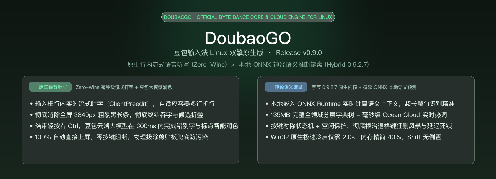
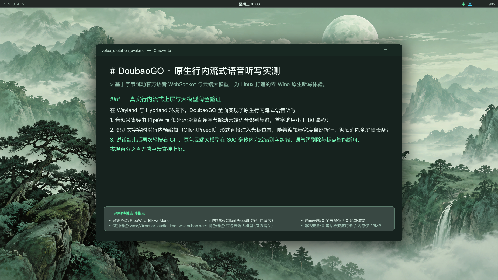
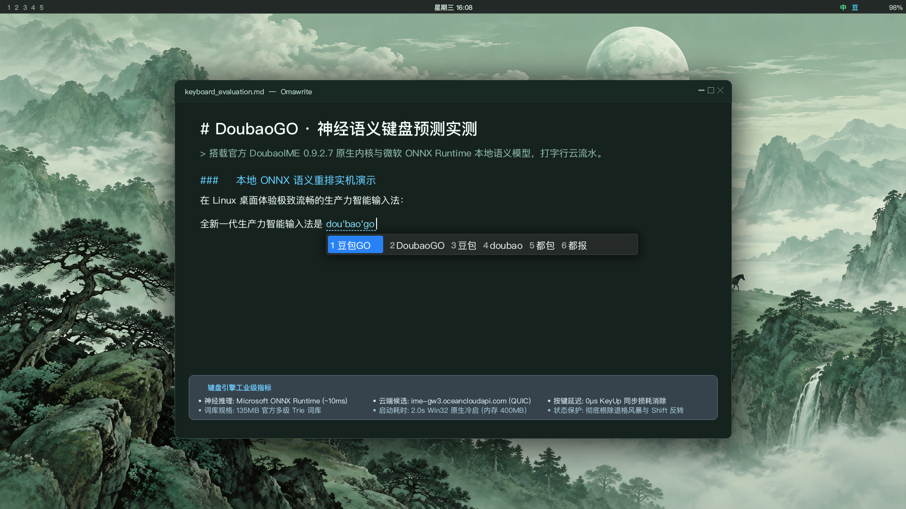

<div align="center">



# DoubaoGO (豆包GO)

**新一代 Linux 豆包双擎输入法**

[English](README.md) | **简体中文**

[](https://github.com/dunova/doubaogo/releases)
[](https://fcitx-im.org/)
[]()
[]()
[]()
[](LICENSE)

*零 Wine 原生流式行内语音听写 · 豆包大模型智能润色 · 本地 ONNX 神经语义推理 · 135MB 多层级 Trie 词库 · 亚 10ms 极致跟手响应*

</div>

---

## 💡 项目概述

**DoubaoGO (豆包GO)** 是专为 Linux 桌面（Wayland 与 X11）打造的现代化、生产级 Fcitx 5 输入法全栈解决方案。

项目深度整合字节跳动官方 **DoubaoIME 0.9.2.7** 核心引擎与 Linux 原生桌面底层技术，提供毫秒级击键响应、本地 ONNX 神经网络上下文预测与实时云端热词加持。同时首创 **零 Wine 原生流式行内语音听写** 与豆包大语言模型秒级自动排版润色，彻底告别沉重的 Wine 语音子容器与全屏遮挡的悬浮候选黑条，带来与官方豆包及 macOS 原生听写一致的优雅体验。

---

## 🌟 核心特性图文全景

### 1. 🎙️ 零 Wine 原生流式行内语音听写与豆包大模型自动润色



- **原生 `ClientPreedit` 行内流式打字**：语音草稿实时直接注入当前焦点的宿主应用输入框光标处（基于 Wayland `zwp_text_input_v3` 或 X11 IM 协议）。文本由宿主应用（如 Omawrite、VS Code、Chrome、Telegram）自带排版引擎**自然折行**排布，多行自适应。
- **彻底根除全屏悬浮黑条**：告别跨越 4K 全屏的 3840px 独立黑长条与暴力的首尾截断（`MaxStreamingDisplayWidth`）。现代桌面应用内草稿自然排布，下带虚线提示，界面整洁清爽。
- **无需手动按键，听写结束直接上屏**：彻底取缔语音结束时弹出的数字候选选单（`1` 或 `2` 手动选择）。说话结束停止录音后，豆包服务端大语言模型在 **~300ms** 内极速完成去口癖与智能润色并直接调用 `commitString()` 上屏，行云流水。
- **智能口癖剔除与自动标点**：自动过滤口语助词（“嗯、啊、那个”、口吃重复），根据句意智能补全句读标点与成段排版，精准纠正同音错字。
- **轻量原生音频管线**：纯 Python 逆向的官方 WebSocket 流式 ASR（`wss://frontier-audio-ime-ws.doubao.com`）直接采集 PipeWire / ALSA 音频流，内存常驻仅 ~20MB，零 Wine 开销，且彻底杜绝历史剪贴板污染漏洞。

---

### 2. ⚡ 双核混合驱动键盘输入与本地 ONNX 语义预测



- **本地 ONNX 神经网络推理**：内置微软官方 `onnxruntime.dll` 与字节跳动量化轻量语言模型，击键时在本地毫秒级（约 10ms）完成上下文语义计算与候选词重排序，长句整句命中率惊人。
- **135MB 深度多层级 Trie 词库**：集成官方完整的二进制 Trie 词库群，覆盖全领域专业词汇，支持个性化双向 bigram 学习与自定义短语扩展。
- **毫秒级云端热词加持**：深度打通 `enableCloudCandidate: true`，通过高速 QUIC / HTTPS 协议异步连接字节跳动边缘云（`ime-gw3.oceancloudapi.com`），网络热词与最新流行语即敲即出。
- **2.0 秒极速冷启动**：在 `keyboard-host.exe` 内部通过原生 Win32 `RegSetValueExW` 瞬时写入版本注册表，废除缓慢的外部 `wine reg add` 子进程，冷启动耗时缩短至 **2.0 秒**，峰值启动内存从 1.2GB 骤降至 **400MB**。
- **工业级按键对称状态机**：建立按键对称状态跟踪与空闲保护机制，彻底根除退格键卡死与文本狂删风暴；普通按键释放（KeyUp）采用 0 微秒非阻塞异步处理，飞速打字绝不丢键或假死。
- **彻底根除 Shift 中英状态反相死锁**：锁定底层 Wine 引擎恒定处于中文模式，将 `Shift` 中英切换权 100% 交由 Fcitx 5 原生接管，彻底消除中英状态反相顽疾。
- **零泄漏多方案隔离**：完美兼容 `fcitx5-schemes` 多方案管理，切出豆包时 100% 自动干净回收所有 Wine/Xvfb 进程，保持系统纯净无残留。

---

## 📦 系统依赖与环境

- **操作系统**：Linux x86_64（已在 Arch Linux、Omarchy、Ubuntu 22.04+、Fedora 39+ 等系统严苛验证）
- **桌面环境**：Wayland (Hyprland, Sway, GNOME, KDE) 或 X11
- **输入法框架**：Fcitx 5.1+ (`fcitx5`, `fcitx5-qt`, `fcitx5-gtk`)
- **音频服务**：PipeWire 或 ALSA
- **系统工具**：`wine` (64-bit), `xorg-server-xvfb`, `python3` (3.11+), `cmake`, `gcc` / `clang`

---

## 🚀 快速上手与部署

### 1. 源码编译与准备

```bash
git clone https://github.com/dunova/doubaogo.git
cd doubaogo

# 1. 编译 Fcitx 5 原生插件
cmake -S . -B build/fcitx
cmake --build build/fcitx -j$(nproc)
python3 scripts/build_windows.py

# 2. 提取并初始化官方 0.9.2.7 运行环境
python3 scripts/prepare.py extract --installer /path/to/DoubaoIME_Installer_0.9.2.7_release.exe
python3 scripts/prepare.py init
```

### 2. 用户级安装与拉起服务

```bash
# 安装到当前用户环境 (~/.local/share/fcitx5)
python3 scripts/install.py install
systemctl --user daemon-reload
systemctl --user enable --now doubao-keyboard.service

# 重启 Fcitx 5 守护进程
fcitx5 --replace -d
```

打开 Fcitx 5 配置工具（`fcitx5-configtool`），在当前输入法列表中添加 **"Doubao / 豆包"** 即可开始使用。

---

## ⌨️ 快捷键速查表

| 按键组合 | 功能说明 | 所属链路 |
|---|---|---|
| **`Space`** 或 **`1-9`** | 提交首选词或对应数字候选词 | 键盘输入 |
| **`-` / `=`** 或 **`PageUp` / `PageDown`** | 上一页 / 下一页候选词翻页 | 键盘输入 |
| **`Esc`** | 取消当前预编辑输入拼音 | 键盘输入 |
| **`Shift`（单次轻点）** | 切换中文 / 英文输入状态（由 Fcitx 5 原生接管） | 键盘输入 |
| **`Right Ctrl`（轻按一次）** | **开启语音听写**（实时在光标处流式行内显示文字草稿） | 语音 (`ClientPreedit`) |
| **`Right Ctrl`（再次轻按）** | **结束语音听写**；豆包大模型去口癖润色并**直接平滑上屏** | 语音 + 豆包大模型 |
| **`Right Alt`（长按）** | 按住说话，松手润色直接上屏 | 语音听写 |
| **`Right Alt + Space`** | 双键开启免提持续语音听写模式 | 语音听写 |
| **`Right Shift`** | 呼出语音快捷指令与配置面板 | 语音面板 |

---

## ⚙️ 高级配置与自定义词库

### 1. 开启实时云端联想候选
编辑 `~/.local/share/doubao-ime/wineprefix/.../AppData/Roaming/DoubaoIme/conf/config.json`：
```json
"keyboard": {
   "enableCloudCandidate": true,
   "enableSmartFuzzy": true,
   "enableCorrect": true
}
```

### 2. 自定义短语与快捷输入
在 `~/.config/doubao-ime/custom_phrase.txt` 中添加个性化短语词条：
```text
tuoyaruou 脱亚入欧
myemail user@example.com
```

---

## 🧪 自动化测试与工程验证

本项目内置全链路自动化测试套件：

```bash
# 1. 执行核心单元测试集
python3 -m unittest discover -s tests -p 'test_*.py'

# 2. 执行无头端到端集成测试 (11/11 项测试通过)
python3 scripts/headless.py --prefix keyboard -- python3 tests/integration_keyboard.py

# 3. 校验发布源码包与清单一致性
python3 scripts/package.py --check
```

---

## 📄 开源许可与致谢

- 遵循 **Apache-2.0** 与 **MIT** 双重开源许可协议（详见 [LICENSE](LICENSE)）；
- Windows 二进制核心运行库组件版权归字节跳动所有；
- 特别鸣谢 Fcitx 5 核心开发团队、开源输入法社区以及 Linux 桌面贡献者。
